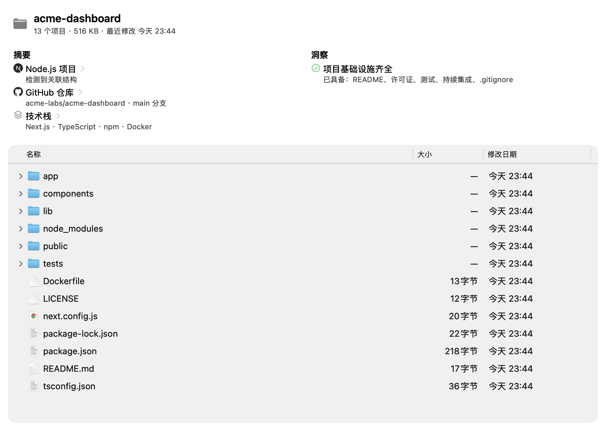
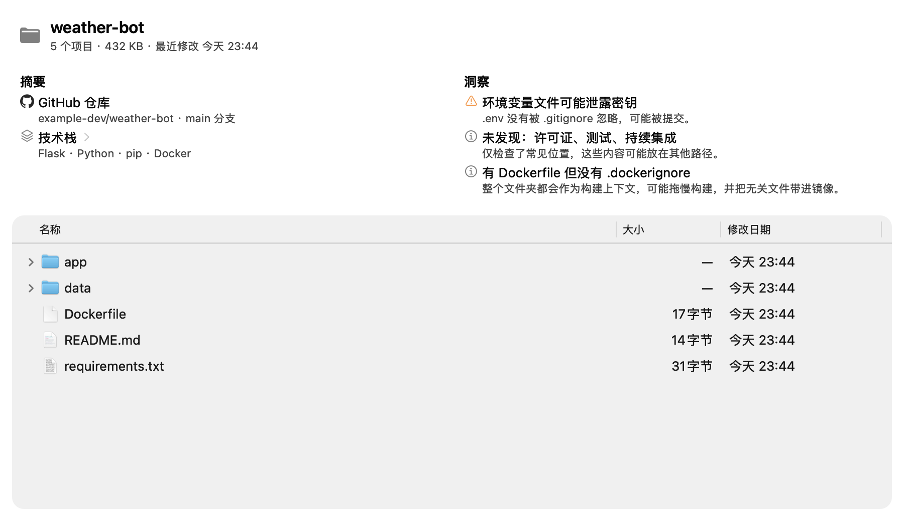
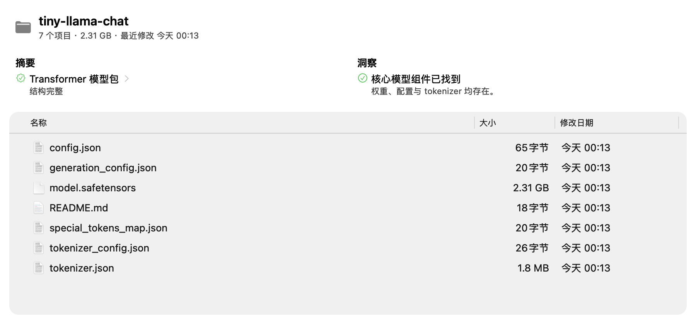
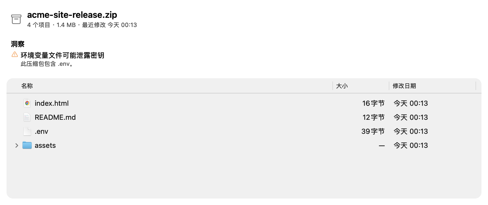
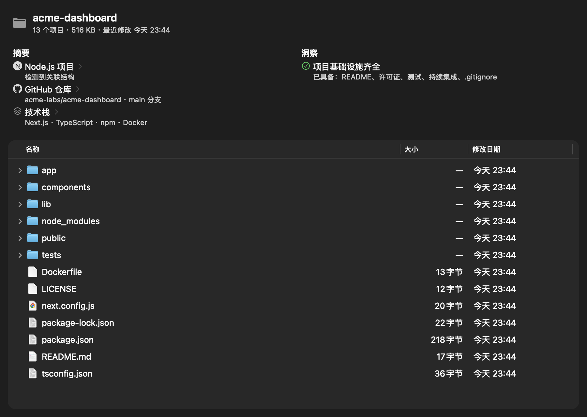

<p align="center">
  
</p>

<h1 align="center">InnerPeek</h1>

<p align="center"><strong>在 Finder 里按下空格，看清一个文件夹或 ZIP 是什么。</strong></p>

<p align="center">
  <a href="https://github.com/fjd2004711/InnerPeek/releases/latest">下载最新版</a> ·
  <a href="#安装">安装</a> ·
  <a href="#常见问题">常见问题</a> ·
  <a href="#从源码构建">构建</a> ·
  <a href="CONTRIBUTING.md">参与贡献</a> ·
  <a href="README_EN.md">English</a>
</p>

<p align="center">
  <a href="https://github.com/fjd2004711/InnerPeek/releases/latest"></a>
  
  <a href="LICENSE"></a>
</p>

InnerPeek 是一个 macOS Quick Look 扩展。选中文件夹或 ZIP，按下空格，就能在 Finder 原生的预览窗口里看到目录树，以及一份简短的判断：这是什么项目、用了什么技术、有没有值得注意的问题。不用打开新应用，不用先解压。

## 预览

下面的图片由真实的预览组件渲染，内容是虚构的演示项目。

| Next.js 项目：技术栈与仓库健康度 | Python 服务：发现隐患与缺项 |
| :---: | :---: |
|  |  |

| 模型包：结构完整性 | ZIP：不解压就能提醒 |
| :---: | :---: |
|  |  |

<details>
<summary>深色模式</summary>



</details>

## 它能告诉你什么

- **这是什么**：根据文件结构识别项目类型（Next.js、Django、Spring Boot、Flutter、模型包、Shapefile……），并列出语言、框架、包管理器和构建系统。识别带有可核对的依据，点击摘要行即可展开。
- **仓库信息**：是否是 Git 仓库、远程来自 GitHub 还是其他托管方、当前分支。远程地址里的账号和令牌不会被保留或显示。
- **仓库健康度**：README、许可证、测试、持续集成是否齐全。齐全时只给一句肯定，缺项时才提示。
- **隐患提醒**：未被 `.gitignore` 覆盖的 `.env`、私钥、npm 令牌、凭据文件、`node_modules` 等；ZIP 里同样会提醒。文案只写文件名，不写内容。
- **缺项和冲突**：缺锁定文件、同时存在多个锁定文件、有 Dockerfile 却没有 `.dockerignore` 等。
- **结构完整性**：模型包缺权重或配置、Shapefile 缺伴随文件等。
- **文件树**：逐层展开，显示大小、修改时间和类型图标。ZIP 只读取目录索引，不解压，也不会在磁盘上留下临时文件。
- **中文和英文**：预览语言可跟随系统，也可以在设置里固定。

洞察最多显示三条，按严重程度排序；没有值得说的就不说。

## 隐私与安全

- 全部在本机完成，**没有网络访问**，也没有常驻后台服务。
- **只读**：不会修改、移动或删除你的文件。
- 扩展运行在 App Sandbox 中，只能读取你正在预览的位置。
- 扫描有界：默认最多分析 2 层目录、2000 个条目；单个清单文件最多读 256 KB。
- 为了读取设置，扩展声明了一个沙盒例外，只读访问 InnerPeek 自己的偏好设置，详见 [设置与诊断](docs/settings.md)。
- 识别结论是基于文件名、清单和少量内容的启发式判断，**不是**安全审计、病毒或恶意软件检测。

## 系统要求

- macOS 14 或更高版本（Quick Look 预览扩展）。
- Apple Silicon 或 Intel Mac。
- 开发和验证主要在 macOS 27 上进行，较早的系统还没有逐一验证。如果你在其他版本上遇到问题，欢迎提 Issue 并附上[诊断信息](docs/troubleshooting.md#提交-issue-时附上诊断信息)。

## 安装

1. 从 [GitHub Releases](https://github.com/fjd2004711/InnerPeek/releases/latest) 下载最新的 DMG，并可用同一页面的 `SHA256SUMS` 校验。
2. 打开 DMG，把 `InnerPeek.app` 拖进「应用程序」。
3. **第一次打开**：当前发布的应用使用 ad-hoc 签名，没有经过 Apple 公证，macOS 会提示无法验证开发者。请在「应用程序」里**右键 InnerPeek → 打开 → 打开**；或前往 系统设置 → 隐私与安全性，点击页面底部的「仍要打开」。
4. 打开一次 InnerPeek，让系统注册扩展。如有需要，到 系统设置 → 通用 → 登录项与扩展 → 快速查看，确认 InnerPeek 已开启（不同系统版本的菜单路径略有差异）。
5. 在 Finder 中选中文件夹或 ZIP，按空格。

想从源码自行构建并签名，见 [从源码构建](#从源码构建)。

### 访问受保护的位置

普通目录不需要额外授权。若要预览桌面、文稿、下载等受 macOS 保护的位置，请前往：

**系统设置 → 隐私与安全性 → 完全磁盘访问权限 → “+” → 选择 `/Applications/InnerPeek.app` → 打开开关**

授权后重新打开预览。完全磁盘访问并非日常使用的必需条件。

## 设置

打开 InnerPeek，点击右上角的齿轮（或按 ⌘,）：

- **显示**：摘要、技术栈、洞察、品牌图标、隐藏文件、默认展开识别依据。
- **分析**：扫描深度（1–4 层）和最多分析的条目数（500–10000）。
- **语言与外观**：预览语言（跟随系统 / 简体中文 / English）、图标样式（品牌彩色 / 统一单色）。
- **诊断**：检查扩展是否正确注册，一键修复，并可复制不含任何文件内容的诊断信息。

设置在下一次打开预览时生效，无需重启。详见 [设置与诊断](docs/settings.md)。

## 常见问题

<details>
<summary><strong>按空格后看到的是系统自带的文件夹卡片，而不是 InnerPeek？</strong></summary>

通常是 LaunchServices 里残留了旧版本的注册记录。先打开 InnerPeek → 设置 → 诊断，点击「修复 Quick Look」。如果仍不行，见 [故障排查](docs/troubleshooting.md)。

</details>

<details>
<summary><strong>预览 ZIP 会产生临时解压文件吗？</strong></summary>

不会。InnerPeek 只读取 ZIP central directory 中的名称、层级、大小和日期。

</details>

<details>
<summary><strong>为什么有些文件夹没有摘要，只有文件列表？</strong></summary>

InnerPeek 只在有足够依据时才下结论。普通文件夹、照片目录等没有明确结构的内容，只显示文件树。

</details>

<details>
<summary><strong>洞察判断错了怎么办？</strong></summary>

请开一个 Issue，附上文件夹的大致结构（不要上传私人文件）。识别规则是 [数据文件](Knowledge)，大多数修正只需要改 JSON。

</details>

## 从源码构建

项目没有第三方运行时依赖。

1. 克隆仓库，用较新的 Xcode（开发使用 Xcode 27）打开 [`InnerPeek.xcodeproj`](InnerPeek.xcodeproj)。
2. 选择 `InnerPeek` scheme 和 `My Mac`。
3. 在两个 target 的 Signing 中选择你自己的开发团队（没有的话可使用 ad-hoc 签名）。
4. 构建并运行一次，然后在 Finder 中测试 Quick Look。

| 路径 | 作用 |
| --- | --- |
| [`InnerPeek/`](InnerPeek) | SwiftUI 主应用：引导、设置、诊断。 |
| [`InnerPeekQL/`](InnerPeekQL) | Quick Look 扩展与 AppKit 预览界面。 |
| [`Shared/`](Shared) | 内容提供器、分析与识别引擎。 |
| [`Knowledge/`](Knowledge) | 识别规则、文件类型、洞察、翻译（JSON）。 |
| [`Schemas/`](Schemas) | 上述 JSON 的结构说明。 |
| [`Tests/`](Tests)、[`scripts/`](scripts) | 回归测试、审计语料和校验脚本。 |

常用命令：

```sh
scripts/validate-knowledge.sh                 # 校验知识文件（需要 jq）
Tests/run-file-intelligence-regression.sh     # 回归测试
scripts/run-audit-corpus.sh                   # 审计语料
scripts/render-screenshots.sh                 # 重新生成 README 截图
```

推送 `v*` 标签后，GitHub Actions 会构建 DMG、生成 `SHA256SUMS` 并发布 Release。

## 参与贡献

欢迎提交 Issue 和 Pull Request。最容易上手的是**补充数据**：新的文件类型、识别规则、洞察规则和翻译都是 JSON，不需要写 Swift。请先阅读 [CONTRIBUTING.md](CONTRIBUTING.md)。

安全问题请按 [SECURITY.md](SECURITY.md) 私下报告。

## 当前限制

- 只支持文件夹和普通单卷 ZIP；ZIP64、分卷 ZIP 暂不支持，旧编码 ZIP 里的非 UTF-8 文件名可能显示不正确。
- ZIP 目前只显示文件列表和隐患提醒，不做项目识别和仓库健康判断。
- ZIP 内的单个文件不能在预览里打开或导出。
- 表头右上角和滚动条的颜色在个别外观下可能略有差异。
- 设置窗口本身只有中文和英文；预览的语言可以通过翻译文件扩展，见 [本地化](docs/localization.md)。

InnerPeek 专注于快速确认内容结构，不替代文件管理或压缩工具。

## 第三方内容

- 品牌图标来自 [Simple Icons](https://simpleicons.org)（CC0 1.0），许可证与免责声明见 [`Knowledge/Icons`](Knowledge/Icons)。品牌名称和标志归各自权利人所有，在这里仅用于指代对应的技术。

## 许可

InnerPeek 采用 [MIT License](LICENSE)。

## 旧版 Quick Look generator（实验性）

[`Generator/`](Generator) 是早期为 macOS 14 及更早系统编写的 `.qlgenerator`。macOS 15 起系统不再加载这类插件，现在的文件夹预览由扩展直接提供，因此**不需要**安装它。详见 [`Generator/README.md`](Generator/README.md)。
