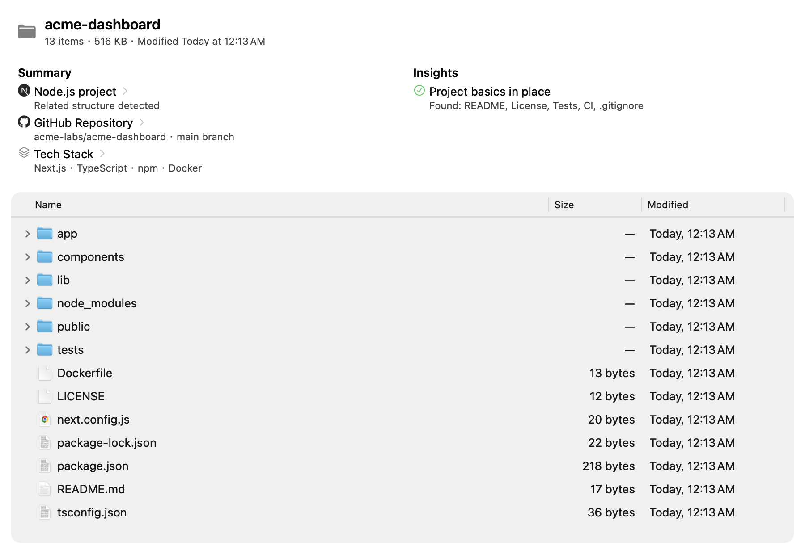
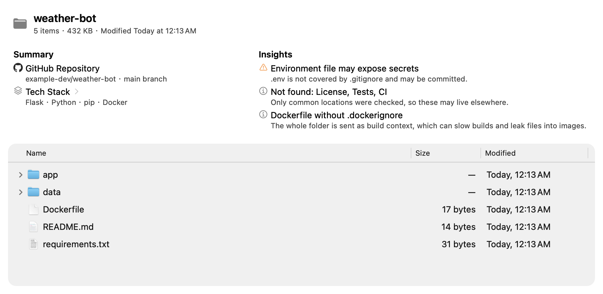
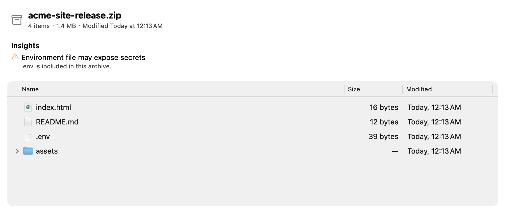
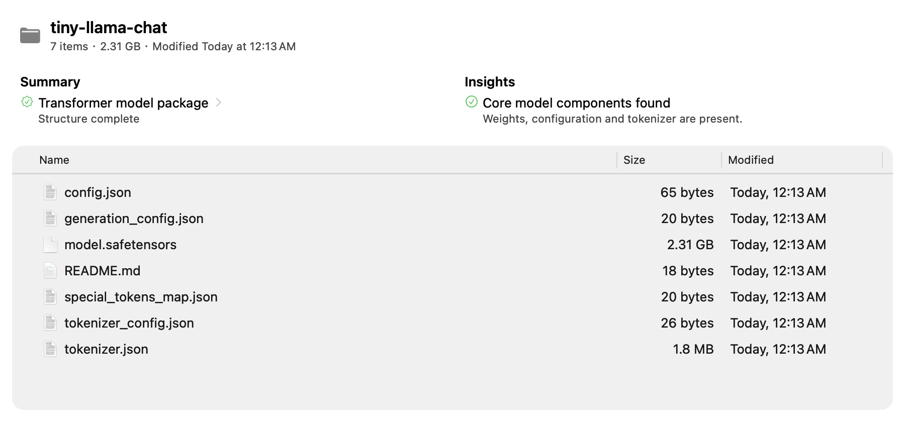
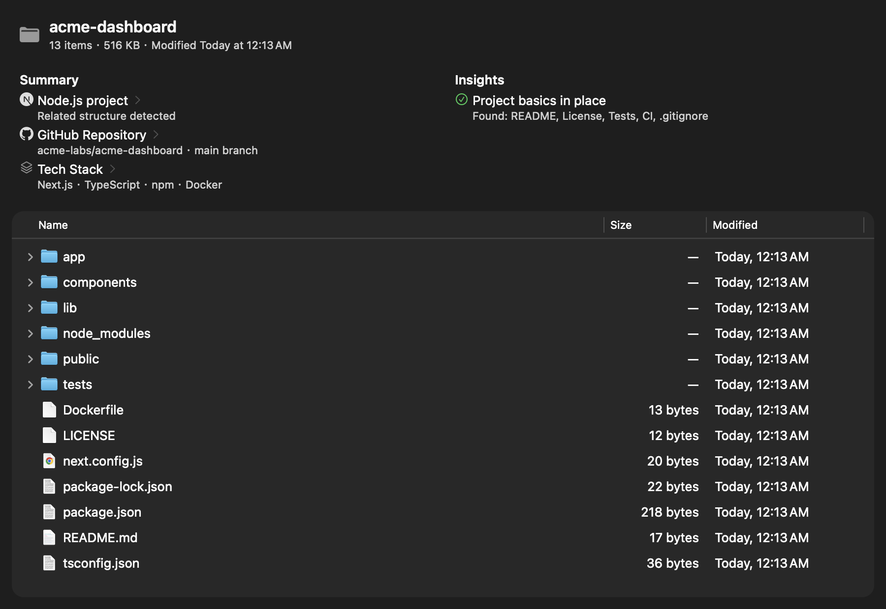

<p align="center">
  
</p>

<h1 align="center">InnerPeek</h1>

<p align="center"><strong>Press Space in Finder and see what a folder or ZIP actually is.</strong></p>

<p align="center">
  <a href="https://github.com/fjd2004711/InnerPeek/releases/latest">Download</a> ·
  <a href="#install">Install</a> ·
  <a href="#faq">FAQ</a> ·
  <a href="#build-from-source">Build</a> ·
  <a href="CONTRIBUTING.md">Contribute</a> ·
  <a href="README.md">简体中文</a>
</p>

<p align="center">
  <a href="https://github.com/fjd2004711/InnerPeek/releases/latest"></a>
  
  <a href="LICENSE"></a>
</p>

InnerPeek is a macOS Quick Look extension. Select a folder or a ZIP, press Space, and Finder's native preview shows the file tree plus a short verdict: what kind of project this is, which technologies it uses, and whether anything deserves attention. No extra app to open, nothing to unzip first.

## Preview

The images below are rendered by the real preview component from fictional demo projects.

<p align="center">
  
</p>

| Python service: risks and gaps | ZIP: warnings without extracting |
| :---: | :---: |
|  |  |
| **Model package: structural completeness** | **Dark mode** |
|  |  |

## What it tells you

- **What it is**: recognises the project type from its structure (Next.js, Django, Spring Boot, Flutter, model packages, Shapefiles…) and lists languages, frameworks, package managers and build systems. Every conclusion carries evidence you can check; click a summary row to expand it.
- **Repository**: whether it is a Git repository, which host the remote points at, and the current branch. Credentials embedded in a remote URL are never kept or shown.
- **Repository health**: README, licence, tests and CI. When everything is there you get one positive line; gaps are only mentioned when they exist.
- **Risks**: an `.env`, private key, npm token, credential file or `node_modules` that `.gitignore` does not cover. ZIPs are checked too. The text names the file, never its contents.
- **Gaps and conflicts**: a missing lockfile, several lockfiles at once, a Dockerfile without `.dockerignore`, and similar.
- **Completeness**: a model package missing weights or configuration, a Shapefile missing a sidecar file, and so on.
- **File tree**: expand level by level with sizes, dates and type icons. ZIPs are read from their central directory only: nothing is extracted and no temporary files are written.
- **English and Chinese**: the preview follows the system language or a language you fix in Settings.

At most three insights are shown, most important first. If there is nothing worth saying, nothing is said.

The full recognition scope is listed in [Supported file types and technologies](docs/supported-file-types.md): 95 file types, 663 extensions, and 60+ languages, frameworks and tools.

## Privacy and safety

- Everything happens on your Mac. **No network access**, no background service.
- **Read-only**: your files are never modified, moved or deleted.
- The extension runs in the App Sandbox and can only read the item you are previewing.
- Scans are bounded: by default 2 folder levels and 2,000 items; any single manifest is read up to 256 KB.
- To read its settings the extension declares one sandbox exception: read-only access to InnerPeek's own preferences. See [Settings and diagnostics](docs/settings.md).
- Conclusions are heuristics based on names, manifests and a little content. They are **not** a security audit or malware scan.

## Requirements

- macOS 14 or later (Quick Look preview extensions).
- Apple Silicon or Intel Mac.
- Development and verification happen mainly on macOS 27; earlier systems have not been checked one by one. If something misbehaves on your version, please open an issue and attach the [diagnostics](docs/troubleshooting.md#attach-diagnostics-to-an-issue).

## Install

1. Download the latest DMG from [GitHub Releases](https://github.com/fjd2004711/InnerPeek/releases/latest). The same page has `SHA256SUMS` for verification.
2. Open the DMG and drag `InnerPeek.app` into Applications.
3. **First launch**: the published app is ad-hoc signed and not notarised by Apple, so macOS says it cannot verify the developer. In Applications, **right-click InnerPeek → Open → Open**, or go to System Settings → Privacy & Security and click **Open Anyway** at the bottom.
4. Open InnerPeek once so the system registers the extension. If needed, check System Settings → General → Login Items & Extensions → Quick Look and make sure InnerPeek is on (the exact path differs slightly between macOS versions).
5. Select a folder or ZIP in Finder and press Space.

To build and sign it yourself, see [Build from source](#build-from-source).

### Protected locations

Ordinary folders need no extra permission. To preview Desktop, Documents, Downloads or other protected locations:

**System Settings → Privacy & Security → Full Disk Access → “+” → choose `/Applications/InnerPeek.app` → switch it on**

Reopen the preview afterwards. Full Disk Access is not required for everyday use.

## Settings

Open InnerPeek and click the gear in the header (or press ⌘,):

- **Display**: summary, tech stack, insights, brand icons, hidden files, expand evidence by default.
- **Analysis**: scan depth (1–4 levels) and the maximum number of items (500–10,000).
- **Language & Look**: preview language (system / 简体中文 / English) and icon style (brand colour / single colour).
- **Diagnostics**: checks whether the extension is registered correctly, repairs it in one click, and copies diagnostics that contain no file contents.

Changes apply the next time a preview opens; no restart needed. See [Settings and diagnostics](docs/settings.md).

## FAQ

<details>
<summary><strong>Pressing Space shows macOS's generic folder card instead of InnerPeek?</strong></summary>

Usually LaunchServices still holds registrations of older builds. Open InnerPeek → Settings → Diagnostics and click **Repair Quick Look**. If that is not enough, see [Troubleshooting](docs/troubleshooting.md).

</details>

<details>
<summary><strong>Does previewing a ZIP create temporary files?</strong></summary>

No. InnerPeek reads only names, hierarchy, sizes and dates from the ZIP central directory.

</details>

<details>
<summary><strong>Why do some folders show a file list but no summary?</strong></summary>

InnerPeek only draws a conclusion when it has evidence. Ordinary folders and photo directories with no recognisable structure show just the file tree.

</details>

<details>
<summary><strong>An insight is wrong. What now?</strong></summary>

Open an issue with the rough structure of the folder (please do not upload private files). Recognition rules are [data files](Knowledge), so most fixes are a JSON edit.

</details>

## Build from source

There are no third-party runtime dependencies.

1. Clone the repository and open [`InnerPeek.xcodeproj`](InnerPeek.xcodeproj) in a recent Xcode (development uses Xcode 27).
2. Select the `InnerPeek` scheme and `My Mac`.
3. Choose your own team under Signing for both targets (ad-hoc signing works if you have none).
4. Build and run once, then test Quick Look in Finder.

| Path | Purpose |
| --- | --- |
| [`InnerPeek/`](InnerPeek) | SwiftUI app: onboarding, settings, diagnostics. |
| [`InnerPeekQL/`](InnerPeekQL) | The Quick Look extension and its AppKit preview UI. |
| [`Shared/`](Shared) | Content providers, analysis and recognition engines. |
| [`Knowledge/`](Knowledge) | Recognition rules, file types, insights and translations (JSON). |
| [`Schemas/`](Schemas) | Structure of those JSON files. |
| [`Tests/`](Tests), [`scripts/`](scripts) | Regression tests, audit corpus and validation scripts. |

Useful commands:

```sh
scripts/validate-knowledge.sh                 # validate the knowledge files (needs jq)
Tests/run-file-intelligence-regression.sh     # regression tests
scripts/run-audit-corpus.sh                   # audit corpus
scripts/render-screenshots.sh                 # regenerate the README screenshots
```

Pushing a `v*` tag makes GitHub Actions build the DMG, create `SHA256SUMS` and publish a release.

## Contributing

Issues and pull requests are welcome. The easiest way in is **data**: new file types, recognition rules, insight rules and translations are all JSON, with no Swift required. Please read [CONTRIBUTING.md](CONTRIBUTING.md) first.

Report security problems privately, as described in [SECURITY.md](SECURITY.md).

## Known limitations

- Folders and ordinary single-volume ZIPs only. ZIP64 and split archives are not supported; non-UTF-8 names in legacy ZIPs may not display correctly.
- ZIPs currently get a file list and risk warnings, but no project recognition or repository-health judgement.
- A single file inside a ZIP cannot be opened or exported from the preview.
- The header's top-right corner and the scroller may differ slightly in colour in some appearances.
- The settings window itself is available in Chinese and English only; preview languages can be extended with translation files, see [Localization](docs/localization.md).

InnerPeek aims at a fast look at structure. It does not replace a file manager or an archive utility.

## Third-party content

- Brand icons come from [Simple Icons](https://simpleicons.org) (CC0 1.0); licence and disclaimer are in [`Knowledge/Icons`](Knowledge/Icons). Brand names and logos belong to their owners and are used here only to refer to the technology.

## License

InnerPeek is released under the [MIT License](LICENSE).

## Legacy Quick Look generator (experimental)

[`Generator/`](Generator) is an early `.qlgenerator` written for macOS 14 and older. macOS 15 and later no longer load such plug-ins, and folder previews are now provided by the extension itself, so you do **not** need to install it. See [`Generator/README.md`](Generator/README.md).
